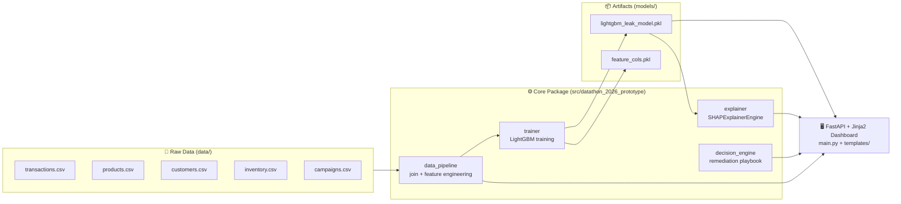
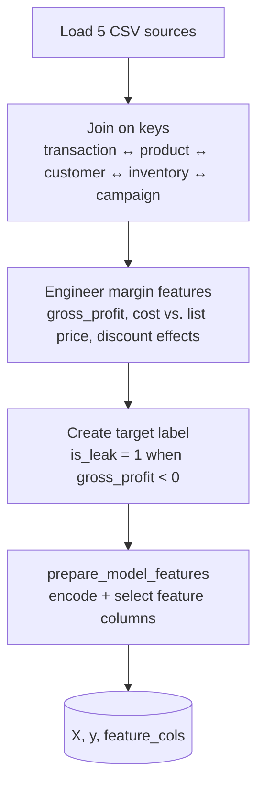
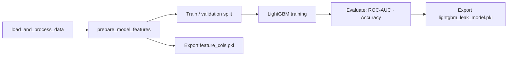

<div align="center">

# 🛡️ AegisMargin

AegisMargin is an intelligent decision-support platform designed to help managers identify potential revenue and margin problems, investigate their underlying drivers using explainable machine learning, and execute immediate remediation playbooks[cite: 1, 2].
### Real-Time Business Decision-Support Engine for Margin Protection

*Detect. Explain. Remediate — before the loss reaches the ledger.*


[](LICENSE)


**Datathon 2026 Submission** · Organized by the Data Science Club (DSC) in collaboration with IIEC, VIT-AP University

</div>
<<<<<<< HEAD
>>>>>>> Stashed changes
=======
>>>>>>> a94ae12a351e09cdfe5afad15ec62495ad5e17b5

---

## 📑 Table of Contents

1. [Overview](#-overview)
2. [Problem Statement & Business Impact](#-problem-statement--business-impact)
3. [Key Findings](#-key-findings)
4. [System Architecture](#-system-architecture)
5. [Data Pipeline](#-data-pipeline)
6. [Model Training Logic](#-model-training-logic)
7. [Explainability Layer (SHAP)](#-explainability-layer-shap)
8. [Decision Engine & Remediation Playbook](#-decision-engine--remediation-playbook)
9. [Model Performance](#-model-performance)
10. [Dashboard](#-dashboard)
11. [Repository Structure](#-repository-structure)
12. [Getting Started](#-getting-started)
13. [Tech Stack](#-tech-stack)
14. [Limitations & Roadmap](#-limitations--roadmap)
15. [Credits & License](#-credits--license)

---

## 🎯 Overview

**AegisMargin** is an intelligent decision-support platform that helps managers **identify revenue and margin leaks, understand why they happen, and act on them immediately**.

Traditional BI dashboards report losses *after* month-end reconciliation, when the damage is done. AegisMargin acts as a **real-time gross-margin guardrail**, evaluating each transaction or product listing at the moment it occurs and pairing every alert with:

| Capability | What it delivers |
|---|---|
| 🔍 **Detection** | Flags transactions likely to generate negative gross margin |
| 🧠 **Attribution** | Explains *why* using SHAP feature contributions per transaction |
| 🛠️ **Remediation** | Produces a severity-ranked action playbook for the manager |
| 📊 **Visibility** | Surfaces executive KPIs and a transaction-level investigator in a FastAPI + Jinja2 dashboard |

---

## 🩹 Problem Statement & Business Impact

### The problem

Margin leakage is rarely a single bug. It hides in the interaction between **supplier cost, catalog price, discount depth, and order quantity**. Businesses typically discover it only in retrospective reporting, and when they do, they lack an explanation of *which lever* caused it.

### Problems AegisMargin addresses

| # | Problem | How AegisMargin cures it |
|---|---|---|
| 1 | **Late detection**: losses found only after month-end close | Per-transaction scoring at order/listing time |
| 2 | **Opaque root cause**: dashboards show *that* money was lost, not *why* | SHAP attribution ranks the drivers behind each flagged order |
| 3 | **Structural pricing defects**: SKUs whose cost exceeds list price lose money on every sale | Dedicated detection of `unit_cost > list_price` SKUs |
| 4 | **Discount erosion**: discounts push otherwise healthy items below cost | Discount depth is a modeled feature and appears in attribution |
| 5 | **No clear next step**: analytics stops at insight | Decision engine converts a flag into a prioritized manager action |
| 6 | **Black-box distrust**: managers won't act on unexplained scores | Transparent, feature-level "Why this is flagged" panel |

---

## 📈 Key Findings

Results from analysis of the provided Datathon dataset (18,000 transactions, 250 products):

| Metric | Value |
|---|---|
| 💸 **Total revenue bleed uncovered** | **$1,572,018.97** lost across negative-margin sales |
| 🧾 **Affected transactions** | **6,829 of 18,000 orders (37.94%)** incurred a direct gross loss |
| 🏷️ **Structurally defective SKUs** | **76 of 250 products (30.4%)** have supplier cost higher than list price |
| 🧱 **Structural defect loss** | **≈ $1.47M**, incurred *before* any customer discount is applied |

> **Insight:** The majority of the bleed is not caused by aggressive discounting. It originates from **pricing/cost misalignment baked into the catalog**. Fixing 76 SKUs addresses the dominant source of loss.

---

## 🏗️ System Architecture

AegisMargin follows a strictly modular design, so data processing, ML inference, explainability, decisioning, and UI are isolated and independently testable.



### Layered view

```
┌──────────────────────────────────────────────────────────────┐
│  PRESENTATION   FastAPI + Jinja2 dashboard (KPIs · Investigator) │
├──────────────────────────────────────────────────────────────┤
│  DECISIONING    Severity-ranked manager remediation playbook │
├──────────────────────────────────────────────────────────────┤
│  EXPLAINABILITY SHAP per-transaction feature attribution     │
├──────────────────────────────────────────────────────────────┤
│  INFERENCE      LightGBM gradient-boosted decision trees     │
├──────────────────────────────────────────────────────────────┤
│  DATA           Multi-table join + margin feature engineering│
└──────────────────────────────────────────────────────────────┘
```

---

## 🔄 Data Pipeline

The pipeline lives in `data_pipeline.py` and exposes two entry points used throughout the project:

| Function | Purpose |
|---|---|
| `load_and_process_data()` | Loads the five source CSVs, joins them, and engineers margin features and labels |
| `prepare_model_features(df)` | Builds the model-ready feature matrix `X`, target `y`, and the ordered `feature_cols` list |



### Source datasets

| File | Role |
|---|---|
| `transactions.csv` | Order-level facts: product, quantity, discount, and realized profit |
| `products.csv` | Catalog attributes: category, `unit_cost`, `list_price` |
| `customers.csv` | Customer attributes for segment-level context |
| `inventory.csv` | Stock context for each SKU |
| `campaigns.csv` | Promotional campaign context |

### Core engineered signals

| Signal | Meaning |
|---|---|
| `gross_profit` | Realized profit on the order; negative values are leaks |
| `is_leak` | Binary target: `1` when `gross_profit < 0` |
| `unit_cost` vs `list_price` | Detects **structural defects** (`unit_cost > list_price`) |
| `discount_pct` | Depth of customer discount applied |
| `quantity`, `category` | Order size and product-category context |

> The feature matrix is persisted as `models/feature_cols.pkl`, guaranteeing that **training and inference use identical column ordering**.

---

## 🧪 Model Training Logic

Training is handled by `trainer.py`, which trains a local **gradient-boosted decision tree (GBDT)** model and exports binary artifacts.



### Design decisions

| Decision | Rationale |
|---|---|
| **LightGBM (GBDT)** | Strong on tabular data, fast to train, handles mixed feature types and non-linear price/discount interactions |
| **Binary classification** (`is_leak`) | Maps directly to a manager decision: *intervene* or *don't* |
| **Probability output** | `model.predict(X)` returns a leak probability, passed to the decision engine to set severity |
| **Persisted feature list** | Prevents train/serve skew between `trainer.py` and the dashboard |
| **`joblib` serialization** | Lightweight model artifact loading for training and inference |
| **Tree-model + SHAP pairing** | `TreeExplainer`-style attribution is exact and fast for GBDTs |

### Retrain the model

```bash
uv run python -m datathon_2026_prototype.trainer
```

> 📝 **Note:** Exact hyperparameters (learning rate, number of leaves, boosting rounds, early stopping, split ratio) live in `trainer.py`. Add them to this section once finalized so results are fully reproducible.

---

## 🧠 Explainability Layer (SHAP)

`explainer.py` provides the `SHAPExplainerEngine` class.

- Computes **per-transaction SHAP values** from the trained LightGBM model.
- Returns a tidy DataFrame of features ranked by contribution (the dashboard shows the **top 5 drivers**).
- Powers the **"Why This Is Flagged"** panel so every alert is auditable.

```python
explainer = SHAPExplainerEngine()
shap_df = explainer.explain_record(X)   # ranked feature attributions for one order
```

**Why it matters:** a manager sees not just *"this order is risky"* but *"cost-to-list ratio and a 25% discount are the main reasons."* This is the difference between an alert and an action.

---

## 🛠️ Decision Engine & Remediation Playbook

`decision_engine.py` turns a flagged transaction into concrete steps.

```python
actions = generate_manager_remediation(transaction_row, leak_probability)
```

Each returned action contains:

| Field | Description |
|---|---|
| `severity` | `CRITICAL`, `HIGH`, or lower-priority informational level |
| `issue` | Plain-language description of the detected problem |
| `action` | Recommended manager step (e.g., reprice SKU, cap discount, renegotiate supplier cost) |

Severity maps to the UI treatment: 🔴 **CRITICAL** (error banner) → 🟠 **HIGH** (warning banner) → 🔵 **Other** (info banner).

---

## 📊 Model Performance

| Metric | Reported value |
|---|---|
| **ROC-AUC** | **1.00** (README/analysis) · **0.992** (shown in dashboard KPI) |
| **Accuracy** | **100%** on local tabular transaction records |
| **Algorithm** | LightGBM (GBDT) |

### ⚠️ How to read these numbers

Near-perfect scores are expected here and should be interpreted correctly:

- The target `is_leak` is defined by `gross_profit < 0`, and `gross_profit` is itself a deterministic function of **list price, unit cost, discount, and quantity**, which are also the model's inputs. The model therefore *recovers a known rule* rather than forecasting an uncertain event.
- The value of AegisMargin lies in **real-time flagging, SHAP attribution, and actionable remediation**, not in leaderboard-style predictive accuracy.
- For forward-looking use (scoring *prospective* orders and new listings), validate on a **time-based hold-out**, confirm no label-derived columns (e.g., `gross_profit`) are present in the feature set, and report precision/recall alongside AUC.
- The README (1.00) and dashboard (0.992) AUC figures differ. Align them to a single, reproducible evaluation run before publishing results.

---

## 🖥️ Dashboard

The FastAPI application (`main.py`) serves the Jinja2 dashboard in `templates/index.html` and the JSON inspection/remediation endpoints.

**Executive KPI strip**

| KPI | Content |
|---|---|
| Total Margin Loss | Absolute sum of all negative gross profit |
| Negative Margin Sales | Count and share of loss-making orders |
| Structural Defect SKUs | Products where cost exceeds list price |
| Model AUC | Engine quality indicator |

**Transaction Loss Investigator**

1. Select a flagged transaction ID.
2. Review order details (product, category, quantity, discount, unit cost, list price, net loss).
3. Inspect the **SHAP "Why this is flagged"** table.
4. Read the **severity-ranked recommended manager actions**.

---

## 📁 Repository Structure

```
AegisMargin/
├── data/                              # Raw input datasets
│   ├── transactions.csv
│   ├── products.csv
│   ├── customers.csv
│   ├── inventory.csv
│   └── campaigns.csv
├── src/
│   └── datathon_2026_prototype/
│       ├── __init__.py
│       ├── data_pipeline.py           # Joins CSVs & engineers margin features
│       ├── trainer.py                 # Trains LightGBM & exports artifacts
│       ├── explainer.py               # SHAP feature-attribution engine
│       └── decision_engine.py         # Automated remediation playbook
├── models/
│   ├── lightgbm_leak_model.pkl        # Trained model
│   └── feature_cols.pkl               # Ordered feature list
├── main.py                            # FastAPI server and dashboard routes
├── templates/
│   └── index.html                     # Jinja2 dashboard
├── app.py                             # Previous dashboard entry point
├── pyproject.toml                     # Project metadata & dependencies
├── uv.lock                            # Locked dependency versions
├── .python-version
├── LICENSE
└── README.md
```

---

## 🚀 Getting Started

### Prerequisites

- **Python 3.13+**
- [`uv`](https://docs.astral.sh/uv/) (recommended) or `pip`

### Installation

```bash
# 1. Clone the repository
git clone https://github.com/Ananthucyber/AegisMargin.git
cd AegisMargin

# 2. Install dependencies (using uv)
uv sync

# --- or with pip ---
python -m venv .venv
source .venv/bin/activate          # Windows: .venv\Scripts\activate
pip install fastapi jinja2 uvicorn joblib lightgbm numpy pandas scikit-learn shap xgboost
```

### Run the dashboard

```bash
uv run uvicorn main:app --reload
```

Then open **http://127.0.0.1:8000**. The dashboard lets you select a flagged transaction, inspect its SHAP drivers and remediation playbook, and submit a remediation action.

### (Optional) Retrain the model

```bash
uv run python -m datathon_2026_prototype.trainer
```

---

## 🧰 Tech Stack

| Layer | Technology |
|---|---|
| Language | Python 3.13 |
| Data | pandas, NumPy |
| Modeling | LightGBM (primary), XGBoost, scikit-learn |
| Explainability | SHAP |
| Serialization | joblib |
| API | FastAPI |
| UI | Jinja2 templates, Tailwind CSS |
| Packaging | uv / `pyproject.toml` |

---

## 🧭 Limitations & Roadmap

**Current limitations**

- Prototype built for a datathon; evaluated on a single provided dataset.
- Target is rule-derived, so reported accuracy reflects rule recovery (see [Model Performance](#-model-performance)).
- Dashboard KPIs for structural defects and AUC are partially hard-coded rather than computed live.

**Roadmap**

- [ ] Time-based validation and precision/recall/PR-AUC reporting
- [ ] Compute all dashboard KPIs dynamically from data and the evaluation run
- [ ] Extend the API to score prospective transactions before checkout and integrate with POS and e-commerce systems
- [ ] Price-optimization recommendations (minimum safe price per SKU/discount)
- [ ] Automated alerting (email/Slack) for CRITICAL leaks
- [ ] Unit tests and CI via GitHub Actions
- [ ] Dockerized deployment

---

## 🙌 Credits & License

- **Original project & author:** Prabal Singh, Ananthu Krishna (upstream repository: [SouLCodes-main/AegisMargin](https://github.com/SouLCodes-main/AegisMargin))
- **Event:** Datathon 2026, Data Science Club (DSC) × IIEC, VIT-AP University
- **License:** See the [LICENSE](LICENSE) file.

<div align="center">

*Protect the margin. Explain the leak. Act in real time.* 🛡️

</div>